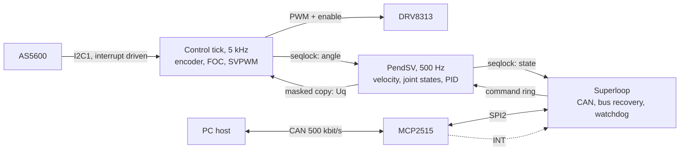

# Project Stride


2-DOF robotic leg with closed-loop field-oriented control. Magnetic encoders on the joints, voltage-mode FOC on an STM32F401, commands over CAN. The follow-up to [Project Talos](https://github.com/vy038/Project_Talos), which was open-loop servo control: Stride is about closing the loop on a real motor, from register-level timers up to the CAN protocol.


---

## Status

| Feature | Status |
|---|---|
| Joint mechanics (housing, hollow shaft, magnet carrier) | ✅ Done |
| Leg design and print | ✅ Done |
| Closed-loop position control on the knee | ✅ Done |
| CfC neural controller on the knee (bring-up firmware) | ✅ Done |
| Drivers: clock, watchdog, PWM, UART, I2C, SPI, MCP2515 | ✅ Done |
| Control: calibration, velocity estimate, PID cascade, joint state machine | ✅ Done |
| CAN protocol: commands, status, feedback, host timeout, E-stop | ✅ Done |
| Host unit tests (21 / 21 passing) | ✅ Done |

---

## Hardware

| Component | Details |
|---|---|
| Actuators | 2x GM2804H-100T gimbal motors, 7 pole pairs |
| Motor drivers | 2x SimpleFOC Mini (DRV8313). No current sensing, so voltage-mode FOC, not torque control |
| Supply | 22 V bench supply, drive voltage capped at 3 V on these motors |
| Encoders | 2x AS5600 (12-bit, I2C). Fixed address 0x36, so each joint needs its own bus |
| CAN | MCP2515 + TJA1050 on SPI2 (the F401 has no CAN peripheral), 8 MHz crystal, 120 Ω at both bus ends |
| Host | CANable on the PC, SocketCAN |
| Controller | NUCLEO-F401RE (Cortex-M4F, 84 MHz) |

### Knee wiring

| Signal | Pin |
|---|---|
| PWM A / B / C (TIM3, 25 kHz) | PA6 / PA7 / PB0 |
| Driver enable (hip enable held low) | PB5 (PB4) |
| Encoder SCL / SDA (I2C1, 400 kHz) | PB8 / PB9 |
| CAN CS / SCK / MISO / MOSI (SPI2) | PB12 / PB13 / PB14 / PB15 |
| CAN INT | PC7 |
| Debug UART (ST-LINK) | PA2 / PA3 |

The MCP2515 module runs on 5 V, so MISO and INT each need a 1 to 4.7 kΩ series resistor. Encoder wires run next to PWM-switched motor leads, so keep them short and routed apart.

### Mechanical design

- 35.2 to 35.4 mm joint pocket for the 35 mm motor body
- Stationary 5 mm hollow shaft, so wiring passes through the joint instead of around it
- Slip-fit magnet carrier on the rotating bell, AS5600 on the stator face with about 1 mm air gap
- M2.5 fasteners into brass heat-set inserts, so joints survive repeated disassembly

---

## Firmware

STM32Cube HAL/LL on PlatformIO, C11, no Arduino and no RTOS. Key design choices:

- Hand-rolled voltage-mode FOC: inverse Park + SVPWM, d = 0, computed every 200 µs from the encoder angle
- Non-blocking encoder reads: the tick starts a read and uses the result on the next tick, so it never waits on I2C
- Fixed-rate 500 Hz outer loop: angle P → velocity PI, with a gravity feedforward term
- Non-blocking calibration state machine that checks the rotor moved as far as it should
- Pure logic (FOC, PID, velocity, calibration, joint states, CAN dispatch) with no hardware dependency, tested on the PC
- One build drives one motor. A joint is a pin block in `config.h`

### Runtime architecture



**Shared data** (every item has exactly one writer)

```c
static seqlock_t enc_lock;    // tick -> everyone: angle, fail count, lost
static drive_t   drive;       // PendSV -> tick: Uq, calibration, enable. copied with IRQs masked
static ring_t    cmd_ring;    // superloop (CAN) -> PendSV: joint commands
static seqlock_t ctrl_lock;   // PendSV -> superloop: velocity, Uq, state, faults
```

A seqlock only works when the reader has lower priority than the writer. The tick outranks PendSV, so in that direction PendSV masks interrupts around the copy instead of making the tick retry forever.

### Contexts

**Control tick** `P0 · 5 kHz (TIM2)`
Collects the last encoder read, starts the next, converts to joint angle, computes the field angle and writes PWM. Owns the PWM timer and the driver enable pin.

**I2C event/error** `P1 · per read`
Carries the encoder read in the background. On any error the interrupts are switched off at once, which guards against an IRQ storm seen during bring-up.

**Outer loop** `P2 · 500 Hz (PendSV)`
Triggered by every 10th tick, so it stays phase-locked without a second timer. Applies queued commands, estimates velocity, runs the joint state machine and PID. Owns the joint state.

**CAN INT** `P3 · per frame (EXTI)`
Sets a flag, nothing else. SPI is only ever touched by the superloop.

**Superloop** `free-running`
Drains the CAN controller, dispatches commands, sends status and feedback, recovers the I2C bus, and kicks the watchdog only if the tick has advanced.

---

## Logic Flow

```
IDLE        -> CALIBRATING   ENABLE, not yet calibrated
IDLE        -> CLOSED_PID    ENABLE, already calibrated
CALIBRATING -> CLOSED_PID    done, holds where it is
CALIBRATING -> FAULT         rotor didn't move as expected, or encoder lost
CLOSED_PID  -> FAULT         encoder lost (the next ENABLE recalibrates)
FAULT       -> ENABLE        clears faults and tries again
any state   -> IDLE          DISABLE, E-STOP or host timeout
```

**Calibration:** hold the stator field at a known angle until the rotor settles, read the encoder, nudge the field a quarter electrical turn, and read again. The first reading gives the offset, the direction of the second gives the sign.

**Enable:** refused outside ±0.5 rad of zero, or if the encoder failed its boot check. The target starts at the current angle, so the joint holds instead of jumping.

### Safety

- Hardware watchdog (150 ms), kicked only when both the superloop and the control tick are alive
- HardFault handler cuts both motor driver enables
- Encoder lost after 10 ms of failed reads: driver off, with bus recovery in the background
- Target clamped to ±0.5 rad, drive voltage clamped to 3 V
- CAN-enabled joint disables after 500 ms without a host frame
- E-stop (ID 0x000) latches until an explicit ENABLE

---

## CAN Protocol

CAN 2.0A, 500 kbit/s. `ID = node << 5 | command`, knee is node 1. Full layout in [`can_proto.h`](firmware/src/can/can_proto.h).

| Knee ID | Message | Direction | Payload |
|---|---|---|---|
| `0x000` | E-STOP | host → all joints | none |
| `0x020` | HEARTBEAT | host → leg | none |
| `0x021` | DISABLE | host → leg | none |
| `0x022` | ENABLE | host → leg | none |
| `0x023` | SET_TARGET | host → leg | float32 rad |
| `0x024` | SET_VLIMIT | host → leg | float32 volts |
| `0x030` | STATUS, 10 Hz | leg → host | state, faults, last command and result, encoder errors, time since host |
| `0x031` | FEEDBACK, 50 Hz | leg → host | float32 angle, float32 velocity |

Frames with a wrong length or a non-finite number never reach the joint, and set a fault bit.

---

## CfC Controller

A small closed-form continuous-time (liquid) neural network, trained to imitate the PID from logged data. On the bring-up firmware it matched PyTorch on-chip to within 5.1e-7 and drove the knee.

In v1 it is compiled in and checked against golden vectors at boot, but no command can switch it on. The velocity estimate changed in the rewrite, so the model needs retraining on v1 data first. It will fall back to PID on more than 0.3 rad of error or a non-finite output.

---

## Performance

| Metric | Target | Result |
|---|---|---|
| Encoder read at 400 kHz | within one 200 µs tick | ~0.15 ms (bring-up) |
| Host timeout | 500 ms | ~476 ms (bring-up) |
| CfC step | fits the 500 Hz loop | ~168 µs (bring-up) |
| CfC settled error | | 0.009 to 0.021 rad (bring-up) |
| Flash / static RAM | | 43 KB / 1.4 KB (v1 build) |
| Host unit tests | all pass | 21 / 21 |

---

## Build & Flash

```bash
cd firmware
pio run -e nucleo_f401re -t upload
pio device monitor
pio test -e native          # pure-logic tests, no board needed
```

Talk to the leg from the PC:

```bash
# from the repo root
pip install python-can
sudo ip link set can0 up type can bitrate 500000
python pc/can_host.py       # enable | disable | estop | t <rad> | vlim <volts> | fb | quit
```

### Bench test builds

Each test is a build flag, for example `PLATFORMIO_BUILD_FLAGS="-DCAN_TEST=2" pio run -t upload`. **Support the leg for any `JOINT_TEST`: a fault drops it.**

| Flag | Test |
|---|---|
| `WDG_TEST=1..3` | Watchdog reset: no kick, HardFault (driver supply off), dead tick |
| `OPENLOOP_TEST=1` | Open-loop spin, motor off the leg |
| `COMMUTATE_TEST=1` | Calibrate, then spin from the encoder, motor off the leg |
| `JOINT_TEST=1..3` | On the leg: hold, step response, gravity sweep (fit with `pc/fit_gravity.py`) |
| `CAN_TEST=1..3` | SPI wire loopback, controller loopback, live bus |
| `PENDSV_LOAD_US=150` | Fake CfC load, to check tick timing holds |

---

## Project Structure

```
Project_Stride/
├── CAD/                       # joint and leg parts (STL)
├── firmware/                  # PlatformIO project, NUCLEO-F401RE
│   ├── platformio.ini         # envs: nucleo_f401re, native (tests)
│   ├── lib/cfc/               # vendored CfC cell
│   ├── src/
│   │   ├── main.c             # control tick, outer loop, superloop
│   │   ├── config.h           # every pin and constant
│   │   ├── seqlock.h, ring.h  # lock-free sharing between contexts
│   │   ├── cfc_ctrl.c/h       # CfC controller and boot golden check
│   │   ├── drivers/           # uart, wdg, pwm3, i2c, as5600, spi, mcp2515
│   │   ├── bldc/              # pure logic: foc, calib, vel, pid, joint
│   │   └── can/               # protocol, dispatch, node
│   └── test/                  # host unit tests
└── pc/
    ├── can_host.py            # CAN host, mirrors can_proto.h
    ├── fit_gravity.py         # gravity feedforward fit
    ├── capture_log.py         # CfC training log capture
    ├── train_cfc_controller.py
    └── cfc_export.py, make_golden_header.py
```
